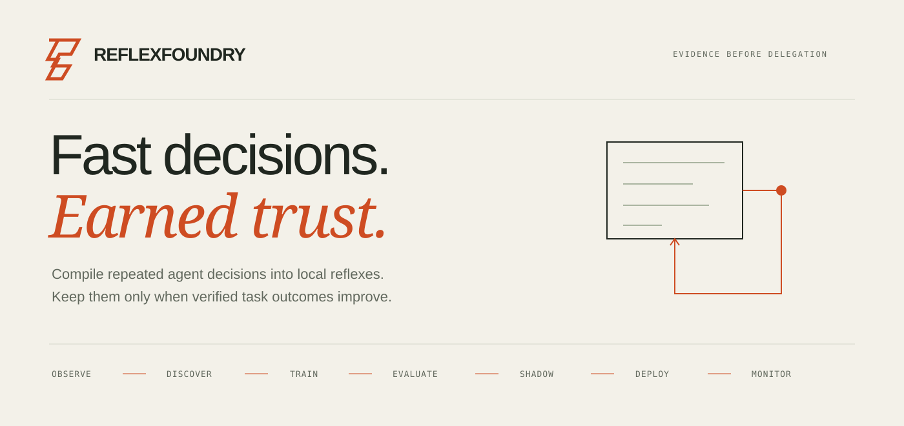
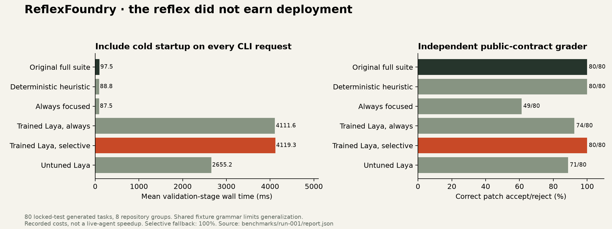
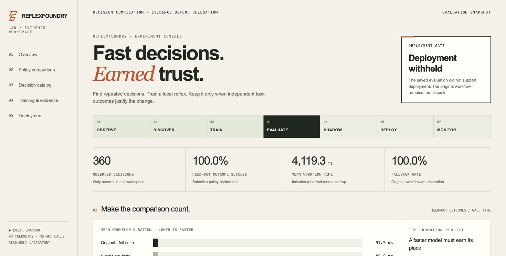

<p align="center"></p>

<p align="center">
  <a href="https://github.com/nazeeh111/ReflexFoundry/actions/workflows/ci.yml"></a>
  <a href="LICENSE"></a>
  <a href="https://github.com/nazeeh111/ReflexFoundry/releases"></a>
</p>

**Teach agents which decisions no longer need expensive deliberation.**

ReflexFoundry finds repeated, bounded decisions in explicitly shared workflow records, adapts a local [Laya](https://github.com/NandhaKishorM/laya) decision head, and checks whether using it would improve independently verified task outcomes. It includes a small Python CLI, an offline evidence laboratory, and a Codex skill integration.

A fast model can still make a workflow slower or less reliable. ReflexFoundry includes startup and fallback costs, compares against a transparent heuristic, and blocks deployment when the evidence fails. A rejected policy is a useful result.

**v0.2.2 experimental preview.** The executed benchmark concerns validation of supplied coding patches in generated Python repositories. It does not establish improvements in autonomous coding, production repositories, subscription usage, dollars, or energy. The current source also executes a separate [public-source context retrieval study](docs/context-benchmark.md). Its source-coverage outcomes do not establish autonomous coding improvements. See the [research basis](docs/research.md) and [evaluation boundaries](docs/evaluation.md). The [0.1.1 fixes](CHANGELOG.md) tighten validation and shadow evidence; the original model and benchmark remain withheld and unchanged.

## Try it without a model

Python 3.11 or newer. No API key, paid service, or model download is needed for this path.

```bash
git clone https://github.com/nazeeh111/ReflexFoundry.git
cd ReflexFoundry
python3 -m venv .venv
source .venv/bin/activate
python -m pip install -e .

reflex specs
reflex benchmark --output runs/first-look --small
reflex discover --workspace runs/first-look
reflex lab --workspace runs/first-look --output runs/first-look/lab.html
```

Open the generated `lab.html`, or run `reflex serve --workspace runs/first-look` for the local, read-only Lab. The small demo executes real checks on fresh generated fixtures. It is intentionally too small for model promotion. Each benchmark run needs a fresh output directory.

For a complete walkthrough, use the [quickstart](docs/quickstart.md). To inspect the already trained research head without retraining, follow the [model artifact guide](docs/model-artifacts.md). Package installation is from source; a PyPI publication is not implied.

## What the tool does

| Stage | Evidence produced |
| --- | --- |
| **Observe** | Explicitly authorized records, allowed input fields, redacted common secrets and personal identifiers. |
| **Discover** | Recurring supported decision families, choice counts, and an outcome-based opportunity estimate. |
| **Train** | A specialized Laya head trained on the training split, with hashes and provenance. |
| **Evaluate** | Separate calibration, promotion and test groups; task outcomes, timing, uncertainty, and baseline comparisons. |
| **Shadow** | Local proposals with the original fallback still returned. Candidate outcomes require independent checking. |
| **Deploy** | Explicit, bounded opt-in only after the held-out gate and verified shadow evidence pass. |
| **Monitor** | Recorded outcomes, artifact identity, input drift checks, abstention, decision budgets, and rollback history. |

Discovery starts with two predefined decision families. It does not infer arbitrary new APIs or discover hidden internal reasoning.

| Decision | Choices | Fallback | Current scope |
| --- | --- | --- | --- |
| `test-scope-v1` | Focused checks or full suite | Full suite | Training and executed evaluation. A suggestion for the next validation action; required final checks still apply. |
| `context-route-v1` | Symbol lookup or repository search | Repository search | Observation, discovery, outcome-aware training and evaluation with bounded public-source retrieval actions. See the separate study and its limits. |

The learned model never grants permissions, accesses credentials, approves security decisions, or executes the returned action. Codex keeps its native tools and permission controls.

## First result: keep the original workflow

The first trained policy **did not earn deployment**. On the locked 80-task fixture test, the conservative gate fell back every time. It preserved correctness while adding substantial model cost.

| Policy | Correct validation outcomes | Accounted mean time per task |
| --- | --- | --- |
| Original full suite | 80 / 80 | 97.5 ms |
| Deterministic heuristic | 80 / 80 | 88.8 ms |
| Trained selective policy | 80 / 80, all fallback | 4,119.3 ms |

These are one local MLX experiment's validation-stage results. Model startup and integrity screening were measured and charged on each modeled CLI invocation; this is not a claim that warm inference takes seconds. The learned always-delegate policy made six validation errors. The promotion gate rejected the candidate, as it should. See the [complete results and limitations](docs/results.md) and [executed report](benchmarks/run-001/report.json).



[Watch the 20-second evidence demo](assets/launch/render-v2/reflexfoundry-v0.1.0.mp4). It uses the actual Lab and executed report, including the withheld deployment verdict.

## Train and test a local reflex

```bash
python -m pip install -e '.[train]'
# Optional native Apple Silicon inference:
python -m pip install -e '.[apple]'

reflex benchmark --output runs/experiment-v1
reflex download --output models/base
reflex train --workspace runs/experiment-v1 \
  --base models/base --output models/policy-v1
reflex evaluate --workspace runs/experiment-v1 \
  --policy models/policy-v1 --base models/base
reflex lab --workspace runs/experiment-v1 \
  --output runs/experiment-v1/lab.html
```

The full experiment executes subprocesses, downloads a substantial checkpoint, and trains locally. Runtime depends on hardware. The base revision is pinned in [model.py](src/reflexfoundry/model.py); weights and optional runtimes retain their own licenses. MLX supplies native Apple Silicon inference where the GPU is available; PyTorch supplies the portable CPU alternative with `--backend torch`.

Fresh training exports now finalize tokenizer metadata before their integrity digest is frozen, preserving the original export configuration as provenance. Existing versioned artifacts stay immutable; legacy CPU conversions still require an explicit new version and fresh evaluation.

The training extra requires Git: it installs Laya from the immutable upstream source revision used for this experiment. That source declares version 0.4.16, which was unavailable on PyPI when checked; the pinned Git dependency avoids relying on an unpublished package version. Core installation remains dependency-free.

Inspect `evaluation.json` before attempting deployment. It contains the acceptance decision and reasons, including insufficient evidence, task regressions, failure to beat the heuristic, or negative net time savings. There is no command to force a failed evaluation through the gate.

## A decision is useful only if the task still works

The flagship experiment asks a simple question: **can a local policy choose a smaller test scope without incorrectly accepting a broken patch?**

Each candidate patch is checked with both focused and full tests. A separate checker exercises public behavior and determines whether the patch is correct. A policy succeeds when its validation result agrees with that checker. An incorrect patch can be correctly rejected; a passing focused check can be a false acceptance.

Evaluation compares the original full-suite workflow, a deterministic file-based heuristic, always-focused checks, ordinary untuned Laya, trained always-delegation, and selective delegation. Ordinary Laya is included when `--base` is supplied. Reversed candidate order is checked, uncertainty can cause abstention, and the original fallback is retained. The retrospective stage costs include measured model loading, screening and prediction, but exclude interpreter startup, module imports and complete CLI/agent process time.

The independent checker is separate code, not an independent research organization. Generated repositories share a narrow grammar. Timing repeats measure variability; they do not create new correctness samples. These limits matter when interpreting the report.

## Public repositories and live coding checks

A separate [six-task Toolz/Funcy holdout study](benchmarks/public-repos-v1/README.md) executes pinned upstream full suites and independent contract checks. Full validation was correct on 6/6; focused checks missed two shared-helper mutations. The locked selective policy fell back on all six. This is a small mutation smoke study, not a powered estimate of production reliability.

The [native Codex coding trial](benchmarks/codex-e2e-v1/README.md) includes two actual source repairs, independently verified with Toolz's full suite and a separate public-contract grader. Host initialization and automatic approval review prevented the planned comparison from completing. There are no complete comparable pairs or claimed agent speedups. The shadow trial's changed-artifact refusal is reported separately from genuine trained inference, which is verified in the [local shadow smoke](benchmarks/run-001/shadow-smoke.json).

Additional local evidence includes a [matched label-source ablation](benchmarks/local-imitation-context-v1/README.md) with no observed test-choice advantage from outcome targets, and a [192-prediction wording/alias diagnostic](benchmarks/choice-stress-v1/README.md) showing additional order sensitivity. Both reuse public context inputs and retain their limitations. Neither supports deployment.

A [prepared five-arm native protocol](docs/native-study-v2.md) compares an undelegated agent, a deterministic heuristic, ordinary Laya, trained always-delegate and selective shadow on two public repair tasks. Its cap is 20 new calls. Preparation and local worker checks are separate from native execution; no native call in this protocol is authorized or counted as completed.

## Use it with Codex

Copy the bundled [Codex skill](integrations/codex/skills/reflexfoundry/SKILL.md) into the target repository's `.agents/skills/reflexfoundry/` directory, review it, and invoke `$reflexfoundry` explicitly. See [Codex integration](docs/codex.md) for inputs, shadow verification, event export, and rollback.

The integration uses observable requests and CLI output. It requires no internal hook, transcript scraping, account credential, hosted model call, or replacement agent environment. Event summaries do not automatically become labeled training examples.

## Inspect the evidence

The Lab exposes recorded inputs, policy boundaries, calibration evidence, correctness and latency comparisons, fallback behavior, policy versions, and deployment history. It reads local workspace artifacts. It does not grant deployment authority through the browser.



```text
Consented records → discovery → training split → local Laya head
                                    │
                    calibration → promotion → locked test
                                    │
                        shadow proposals + independent checks
                                    │
                         explicit bounded opt-in → monitoring
                                    └──── failure → original fallback
```

See [architecture](docs/architecture.md), [privacy and security](SECURITY.md), [contributing](CONTRIBUTING.md), and [third-party notices](THIRD_PARTY_NOTICES.md).

## What is original here

Laya already supplies typed decision inference and training. Existing projects such as [stuntd](https://github.com/bladedevoff/stuntd) already learn per-site heads and manage shadow deployment. Selective prediction, calibration, and cost-aware routing are established research areas.

ReflexFoundry's proposed contribution is a concrete **outcome-aware decision compilation** method for bounded coding-workflow decisions: identify an opportunity, specialize a local policy, and require independent task and economic evidence before delegating. This is an experimental method and developer tool, not a scientific-priority claim. The [research review](docs/research.md) documents close precedents and limitations.

## Development

```bash
python -m pip install -e '.[dev]'
ruff check src tests
mypy src/reflexfoundry
pytest -q
python -m build
```

Source is Apache-2.0. The project is independent and is not endorsed by OpenAI, Laya's authors, Apple, or the referenced research projects. Model and dependency licenses are listed separately in [third-party notices](THIRD_PARTY_NOTICES.md).
