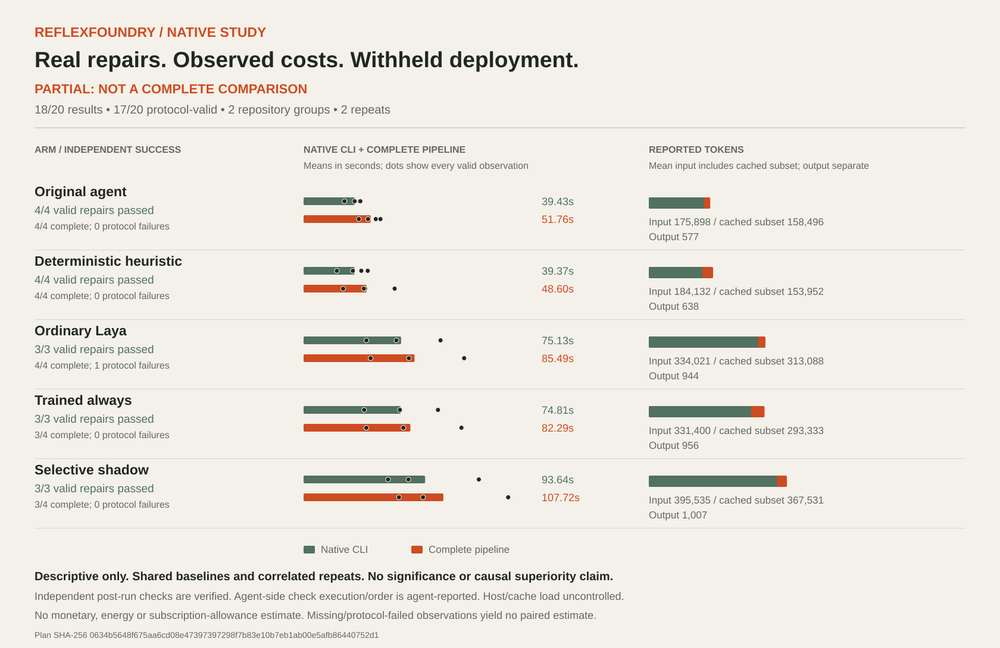

# Historical phase-A report, v0.3.0

The text below describes the released 18-call snapshot. [Current amended results](README.md) include the two reviewed remaining cases. Original execution and analysis bytes remain unchanged. Commands below describe v0.3.0; the current root native-study.json and default Lab show the amended data. The original standalone Lab remains assets/native-demo/lab.html.

# Native coding comparison: stopped incomplete

**18 calls started; 17 protocol-valid repairs passed; one timeout; two calls unattempted.**
This is executed native-agent evidence, not a completed balanced study or deployment approval. The trained head remains withheld. Immutable [prepared metadata](prepared.json) and the [plan](execution/plan.json) retain their historical preparation status. [Results](execution/summary.json), the [stop record](execution/stopped.json) and the [protocol](../../docs/native-study-v2.md) describe what actually happened.

## What ran

Five arms used fresh copies of pinned Funcy and cachetools source with one supplied mutation per repository, two planned repetitions and a 180-second native process limit. The original agent received no ReflexFoundry helper. Interventions required one validated worker receipt; model arms required actual local-inference evidence. Independent focused, full-suite and public-contract checks followed each attempt. Only the intended source file could change.

Direct scoped approval covered up to 20 calls, public source and runtime/policy/report transfer, and subscription-only CLI access. Every actual launch passed normal review. No credentials were inspected or changed. The first outer review request for call 18 failed with “Bad Request” before creating a process or reservation; the unchanged request then passed review. This was not a native retry.

Call 18 reached its native deadline without completed-turn usage or a validated worker receipt. Its unchanged mutant failed all three independent checks. An unfinished command may have begun work; no verified inference outcome is retained. The cause is unknown and is not attributed to model quality. The stop rule prevented calls 19–20. No native retry, resampling or extra call occurred.

## Observed outcomes and costs

| Arm | Started / planned | Protocol-valid | Independently passed / started | Valid CLI mean | Valid pipeline mean |
| --- | --- | --- | --- | --- | --- |
| Original agent | 4/4 | 4 | 4/4 | 39.43s | 51.76s |
| Deterministic heuristic | 4/4 | 4 | 4/4 | 39.37s | 48.60s |
| Ordinary Laya | 4/4 | 3 | 3/4 | 75.13s | 85.49s |
| Trained always | 3/4 | 3 | 3/3 | 74.81s | 82.29s |
| Selective shadow | 3/4 | 3 | 3/3 | 93.64s | 107.72s |

These means exclude protocol-failed observations and have unequal task composition. They are descriptive summaries. The timeout remains visible individually, with unavailable usage, and is not treated as a local model decision error.

The 13 valid matched comparisons use the original agent from the same task and repetition:

| Candidate minus original | Valid pairs / planned | Mean pipeline change | Mean input-token change | Success changes |
| --- | --- | --- | --- | --- |
| Heuristic | 4/4 | −3.16s | +8,234 | 0 in every pair |
| Ordinary Laya | 3/4 | +36.22s | +147,015 | 0 in every valid pair |
| Trained always | 3/4 | +33.02s | +144,394 | 0 in every valid pair |
| Selective shadow | 3/4 | +58.44s | +208,529 | 0 in every valid pair |

Every valid learned comparison took longer and used more reported input tokens. No success improvement was observed. Selective shadow actually inferred and returned search fallback in all three valid shadow calls. No production policy was activated.



[Every observation, missing row, pair and limitation](analysis/analysis.md) is retained. [Machine-readable analysis](analysis/analysis.json) binds its read inputs by SHA-256. [native-study.json](native-study.json) contains the same analysis for the Lab; its display projection excludes candidate source, transcript text and provenance paths.

## Timing, usage and uncertainty

CLI wall time includes native startup and observer collection. Pipeline time adds three independent checks. Readiness hashing and subsequent integrity audits are separate, with all-in attempt time recorded. These are process-inclusive observations, unlike earlier retrospective decision-stage sums. Host load and operating-system/service caches were uncontrolled.

Input tokens include the cached subset. Missing usage is unavailable, not zero. Billing is user-confirmed; neither the hosting route nor billing was independently audited. No dollar, energy, FLOP or remaining-allowance conversion is made.

Only two repositories and one supplied mutation per repository are represented. Repeats are correlated and comparisons share baselines. Funcy was earlier calibration source and cachetools earlier retrieval-test source; these are new repair observations, not new independent retrieval holdouts. Pretraining contamination is neither established nor ruled out. No significance, population reliability or causal superiority claim follows.

Exact agent-side test execution/order is agent-reported. Separate post-run checks are directly observed. Receipts are observable process evidence, not protection against a malicious agent. Four observer source files were explicitly frozen; imported dependencies are [recorded separately](execution/observer-provenance.json). Per-case runtime remained the actual public 0.2.1 wheel.

## Inspect and reproduce

Core-only reanalysis executes no agent, model or candidate code. Choose a fresh output:

```bash
python3 scripts/analyze_native_v2.py \
  --study benchmarks/codex-e2e-v2/execution \
  --provenance benchmarks/codex-e2e-v2/execution/observer-provenance.json \
  --output /tmp/reflexfoundry-native-analysis-new

reflex lab --workspace benchmarks/codex-e2e-v2 \
  --output /tmp/reflexfoundry-native-lab-new.html
```

The [evidence replay](../../assets/native-demo/README.md) uses actual candidate bytes, validated predictions and observer-run checks. Separate measured trials and compressed editorial time are labeled. It is not a screen recording or speed demonstration.

All 18 attempts retain candidate hashes, visible final answers where available, numeric telemetry, public-source candidates and independent check results under `execution/attempts`. Raw JSON events, reasoning text, command arguments and stderr text were not retained. Prompts are public experiment inputs. [SHA256SUMS.json](execution/SHA256SUMS.json) binds the bundle. Full source notices accompany candidates under [licenses](licenses/).

Reanalysis does not authorize new calls. This frozen execution study is halted; its balanced comparison remains incomplete. The plan is never rewritten to erase failed or unattempted observations.
