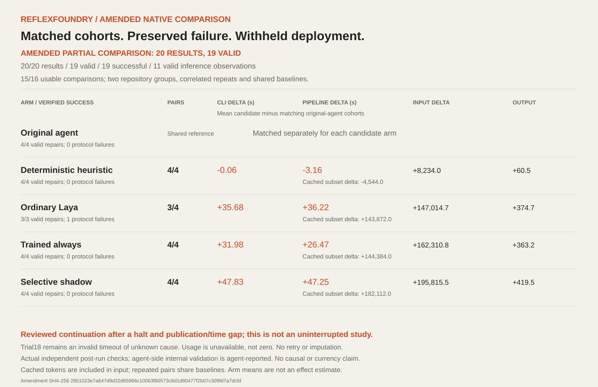

# Native coding comparison: reviewed continuation

**20 coding calls across two phases; 19 independently successful, protocol-valid repair runs; one retained invalid timeout.** There are 11 verified local-inference observations and 15 of 16 valid matched comparisons. All authorized calls are consumed. The trained head remains withheld.

This is an amended, descriptive study. It is neither uninterrupted nor fully protocol-valid. The [original 18-call report](PHASE_A.md), [execution snapshot](execution/summary.json), [stop record](execution/stopped.json) and [original analysis](analysis/analysis.md) remain unchanged. The [current analysis](amended-analysis/analysis.md) reads original observations 1–18 and separate [continuation outputs](continuation/attempts) for 19–20.

## What happened

Five arms used fresh copies of pinned Funcy and cachetools source: original agent, deterministic heuristic, ordinary Laya, trained always and selective shadow. There was one supplied mutation per repository, with two planned repetitions per arm. This is not a sample of 19 different issues. Training used Toolz; these repair repositories were outside training but previously used for retrieval calibration/testing.

The original agent received no ReflexFoundry helper. Interventions required a single validated worker receipt; model arms required actual inference evidence. Only the intended source file could change. Separate observer-run focused, full-suite and public-contract checks followed every attempt. No production policy was activated.

Direct human approval covered at most 20 calls, 180 seconds each, public source/runtime/policy/report transfer and subscription-only CLI access. Every launch passed normal outer review. No credentials were inspected or changed. Call 18 timed out without completed-turn usage or a validated inference receipt, and its unrepaired candidate failed the independent checks. An unfinished command may have begun work; cause is unknown and is not attributed to model quality. Execution halted for review, and v0.3.0 published that snapshot.

The protocol halts launches **for review**, rather than permanently canceling unused calls. Independent scope, source and prepared-amendment reviews preceded a separate observer that ran only original cases 19 and 20, once each, within the original shared cap. Inputs, prompts, runtime, models, graders and native permissions stayed unchanged. Both calls passed with verified inference. Trial 18 was never retried. No sampling, budget increase or permission bypass occurred.

The [amendment](continuation/amendment.json), [review](continuation/review.json), [exact observer source](continuation/continue_native.py) and source manifest preserve that distinction. All 135 registered phase-A files match; two absent public preflight records are supplied separately under continuation/phase-a-supplement. The published phase-A folder is unchanged. The continuation README is a frozen pre-execution recipe, not the current execution count.

## Matched outcomes and costs

Each candidate is compared with the original agent for the same task and repetition. Failed 18 provides no paired estimate or imputed token usage. Other arms have four valid pairs; ordinary Laya has three.

| Candidate minus original | Valid pairs / planned | Mean pipeline change | Mean input-token change | Success changes |
| --- | --- | --- | --- | --- |
| Deterministic heuristic | 4/4 | -3.16s | +8,234 | 0 in every valid pair |
| Ordinary Laya | 3/4 | +36.22s | +147,015 | 0 in every valid pair |
| Trained always | 4/4 | +26.47s | +162,311 | 0 in every valid pair |
| Selective shadow | 4/4 | +47.25s | +195,816 | 0 in every valid pair |

Every valid learned comparison took longer and used more input tokens. No task-success improvement was observed. Selective shadow actually inferred and returned search fallback in all four valid shadow calls. This is a negative result; no policy became eligible for deployment.



[Every observation and pair](amended-analysis/analysis.md), [machine-readable analysis](amended-analysis/analysis.json) and [latest Lab data](native-study.json) retain all 20 rows, including the failure. Descriptive arm means are also available, but unequal task composition must not be treated as an effect estimate.

## Boundaries

CLI wall time includes process startup and observer collection; pipeline time adds three independent checks. Readiness hashing and postcondition auditing are separate, with all-in attempt time recorded. The 180-second native deadline has five seconds of shutdown grace; independent checks each have a 90-second limit. Host load and operating-system/service caches were uncontrolled. The publication/time gap and revised observer phase are explicit.

Input tokens already include cached input. Missing usage is unavailable, not zero. No monetary, energy, FLOP or remaining-allowance conversion is made. Subscription billing is user-confirmed; hosting and billing were not independently audited. Only two repository groups are represented, with correlated repeats and shared baselines. No significance, population reliability or causal superiority claim follows. Pretraining contamination is neither established nor ruled out.

Agent-side internal test execution/order is agent-reported. Separate post-run checks are directly observed. Receipts provide observable process evidence, not adversarial attestation. Native Codex identity is version-based, without binary attestation; receipt cli_sha256 binds the local ReflexFoundry entrypoint. Per-case runtime stayed the actual public 0.2.1 wheel. Recorded observer-source closures are historical; later product versions are not silently substituted into them.

## Inspect and reproduce

Reanalysis reads evidence only and executes no agent, model, candidate or continuation driver. Choose a fresh output:

```bash
python3 scripts/analyze_native_v2.py \
  --study benchmarks/codex-e2e-v2/execution \
  --provenance benchmarks/codex-e2e-v2/execution/observer-provenance.json \
  --continuation benchmarks/codex-e2e-v2/continuation \
  --output /tmp/reflexfoundry-amended-analysis-new

reflex lab --workspace benchmarks/codex-e2e-v2 \
  --output /tmp/reflexfoundry-amended-lab-new.html
```

Omit --continuation to reproduce the unchanged phase-A analysis. The Lab displays only numeric summaries and known arm IDs, never candidate source, transcripts or provenance paths. Its amendment notice is fixed copy rather than arbitrary input text.

The [current evidence replay](../../assets/native-demo/README.md) follows actual inference, the candidate repair, independent checks and amended comparison. Separate trials and compressed editorial time are labeled; it is not a screen recording or speed demonstration. The original master is preserved.

Full source notices accompany retained candidates under [licenses](licenses/). Raw JSON events, reasoning text, agent-issued command arguments and stderr text were not retained. Observer-defined launch arguments and public prompts are experiment inputs. Reanalysis or the presence of a frozen consent record never authorizes further native calls.

Run the retained continuation guard tests without writing Python caches into the immutable evidence directory:

```bash
python -B -m pytest -q tests benchmarks/codex-e2e-v2/continuation/tests
```

The analysis intentionally rejects unregistered evidence files, including caches created by a test runner. CI uses this same cache-free invocation.
