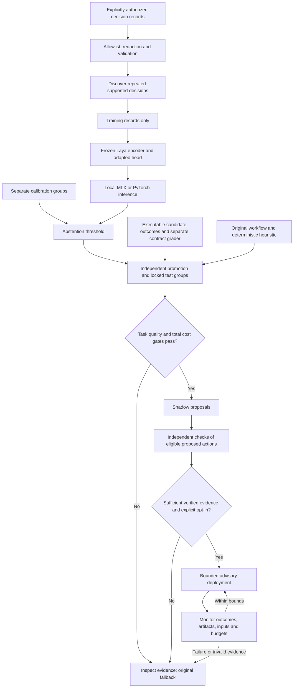

# Architecture

ReflexFoundry separates the learned suggestion from the workflow that executes and verifies it. The CLI and library operate on explicit records and local files. Codex and other callers retain tool execution and permission authority.

The diagram describes the evidence flow. It does not imply that the initial experimental policy passes any gate.

## Small modules, inspectable artifacts

| Module | Responsibility |
| --- | --- |
| `core.py` | Typed specifications, input rules, redaction, record ingestion, split checks and discovery. |
| `benchmark.py` | Generated candidate patches, executed validation actions, separate contract checks and raw timings. |
| `model.py` | Pinned checkpoint download, upstream Laya training, local inference and safe tensor reconstruction. |
| `evaluation.py` | Calibration, paired baselines, task-quality and economic evidence, and promotion decision. |
| `lifecycle.py` | Evidence registration, artifact identity, shadow/deploy transitions, bounded requests and rollback. |
| `codex.py` | Explicitly consented summaries of supported observable command events. |
| `lab.py`, `lab/` | Offline report export and the local read-only evidence interface. |
| `cli.py` | User-facing commands, errors and orchestration of these modules. |

`records.jsonl` is the dataset entry point. A trained model carries a provenance manifest. Evaluation emits predictions and a report, and registration binds them to the actual inference artifacts and catalog. Deployment and request histories retain evidence for inspection.

Atomic writes protect state against interrupted writes. Workspace locking protects lifecycle updates. These are local reliability controls, not an authentication system or proof against an attacker who can rewrite the workspace.

## Backend boundary

Training reuses Laya's native frozen-encoder adaptation. Inference can use Laya-MLX on Apple Silicon or Laya/PyTorch on a portable CPU. The learned head is distinct from the upstream base checkpoint. Model licensing, artifact hashes, calibration configuration and exact runtime versions belong with experimental evidence.

Each CLI `decide` invocation validates the artifact bindings and starts a model. Consequently the relevant primary latency is the cold invocation cost, including integrity screening and model loading. Warm repeated inference may be useful as a diagnostic; it is not the cost of an implemented persistent service. The read-only Lab server does not make policy inference persistent.

## Boundaries of the first release

Discovery recognizes predefined test-scope and context-retrieval specifications. Training and evaluation support one decision family per workspace. Test scope uses patch-validation outcomes; context retrieval uses separately checked source coverage on pinned public repositories. Input drift checking and sustained abstention are conservative warning signals; they do not constitute a general statistical distribution-shift detector.

No component reads hidden reasoning, invokes a paid comparator, signs evidence, or executes a learned action on the agent's behalf. An agent integration must preserve its own safeguards and independent final verification.
